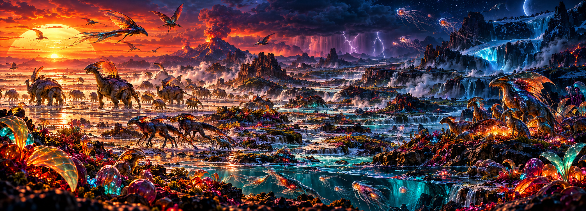

# Desktopia

A living desktop wallpaper for Windows. It shows **Vesper**, an alien world spread across two 4K monitors, where creatures and plants evolve, learn, form societies and die with no scripted behavior.

## Plan

1. **Art direction and world bible.** See [docs/world-bible.md](docs/world-bible.md) and the reference sheets in [docs/references](docs/references).
2. **Wallpaper engine.** Rust and wgpu on DirectX 12. Runs behind the desktop icons across both monitors, with HDR on the HDR one, at low priority with a frame cap, and pauses itself for fullscreen apps or heavy load.
3. **Living simulation.** Genomes grow procedural bodies and small learning brains. Mutation, speciation, emergent social behavior and culture, predation, disease, famine and extinction. Matter is conserved and the world persists across reboots.
4. **Chronicle and polish.** A history view from the tray or a hotkey: species tree, notable individuals, and turning points.

## Status

Step 1 is done: world bible and 10 reference sheets.

Step 2 is in testing. The wallpaper runs behind the icons with a placeholder Vesper landscape (no creatures yet): flowing river, volcano and smoke, storm with lightning, glacier with meltwater, drifting spores, and a twilight band that slides with a four-day season.

## Running it

Download `desktopia.exe` from the [latest build](https://github.com/noalear/Desktopia/releases/tag/latest) and run it. Windows may warn that the app is unrecognised, because it isn't signed: choose **More info**, then **Run anyway**.

Desktopia lives in the tray. Right-click its icon to pause, to start it with Windows, or to quit. Quitting gives the normal wallpaper back.

To start Vesper over, right-click the tray icon and choose **New world…**. After you confirm, the current world ends and life begins again from its first founders. The old world isn't deleted: its save moves to `%LOCALAPPDATA%\Desktopia\world-past` and its history to `chronicle-past`, and an open chronicle window switches to the new world by itself.

It stays out of the way:

- It draws at 30 fps at most, at below-normal priority, in Windows efficiency mode.
- It stops for exclusive-fullscreen games, presentation mode, a locked PC and a sleeping display.
- It skips any monitor covered by a maximized or fullscreen window.
- It drops to 10 fps on battery or while other programs keep the CPU busy.

On a monitor with HDR switched on, it draws in HDR, using the Windows SDR brightness setting as its white so both monitors match.

Settings are in `%APPDATA%\Desktopia\config.toml`, and the logs are in `%LOCALAPPDATA%\Desktopia`.

### The chronicle

Click the tray icon, or press **Win+Alt+V**, to open the chronicle: Vesper's written history. It shows

- what is happening now, and the age the world is in
- the tree of life, every species as a band that swells and thins with its numbers
- the annals, in the order things happened, which you can filter by kind and importance
- every species, with its lineage, what it eats and what eats it, and how its members die
- notable lives: great hunters, leaders, the scarred and the old, and how they died
- peoples, wars, plagues and famines

Click any name to open its page, and press Backspace to go back. The window is a separate process that reads the history from disk, so nothing extra runs while it is closed. The history is kept in `%LOCALAPPDATA%\Desktopia\chronicle`; when a new world starts, the old one moves to `chronicle-past`. Change the hotkey with `chronicle_hotkey` in the settings file, or set it to `""` to have none. `desktopia.exe --chronicle-demo` opens the window on a made-up world.

## Building

- `cargo build --release -p desktopia` builds the wallpaper on Windows.
- `cargo run --release -p preview -- --scale 0.5` renders Vesper to PNG files on any OS with a GPU or a software Vulkan driver.
  Add `--crop X Y W H` to render a window of the world up close, `--lineup` to line up one creature of each body plan in that window, `--frames N --step S` for an animation, and `--storm X STRENGTH`, `--volcano V`, `--lava REACH`, `--ash A`, `--cold X STRENGTH` or `--dust X STRENGTH` to pin the weather. In `--lineup`, the creatures after the first show a sickness, a parasite, a symbiont, bleeding, and light signals in turn.
- `cargo run --release -p vesper-chronicle --example annals -- 5` prints five days of a made-up world's annals.
- `SHOTS=dir cargo test -p chronicle-view --test screenshots -- --ignored` renders each page of the chronicle window to PNG files. Set `CHRONICLE=dir` to render a real chronicle folder instead of a made-up world.

